# Monitor Dimmer

Dimmt beim Spielen automatisch die Nebenmonitore und stellt sie danach wieder her.
Läuft unauffällig im Infobereich der Taskleiste, im Design von Windows 11 (hell und dunkel, mit der Windows-Akzentfarbe).

Sobald ein Spiel aus der Spieleliste im Vordergrund läuft, wendet Monitor Dimmer das passende Profil an: Helligkeit und Kontrast jedes Monitors werden per DDC/CI gesetzt, auf Wunsch laufen zusätzlich Aktionen (z. B. Programme beenden, Energiesparplan oder Audiogerät wechseln). Wird das Spiel beendet, wird alles wieder zurückgestellt.

Neuentwicklung des Monitor Dimmer 1.3 aus dem Jahr 2017; dessen Konfigurationsformat wird weiter gelesen.

| Hell | Dunkel |
|---|---|
| 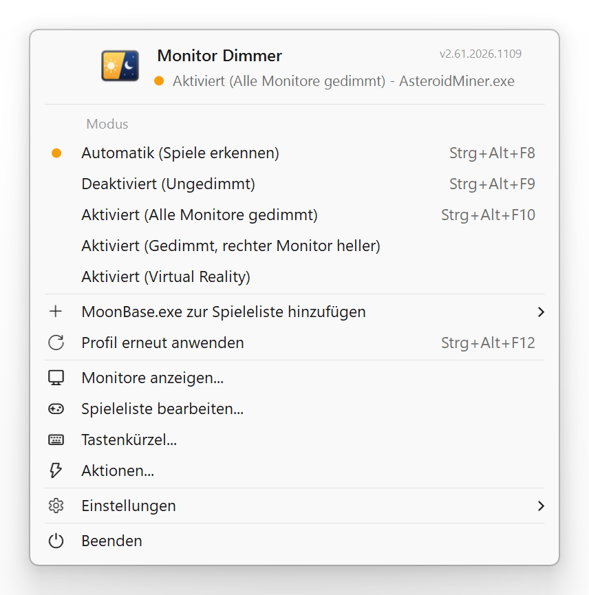 | 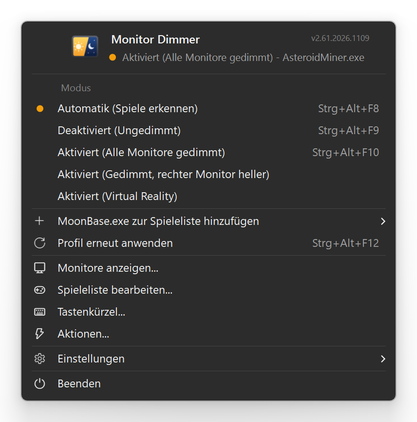 |

Weitere Screenshots

| Hell | Dunkel |
|---|---|
| 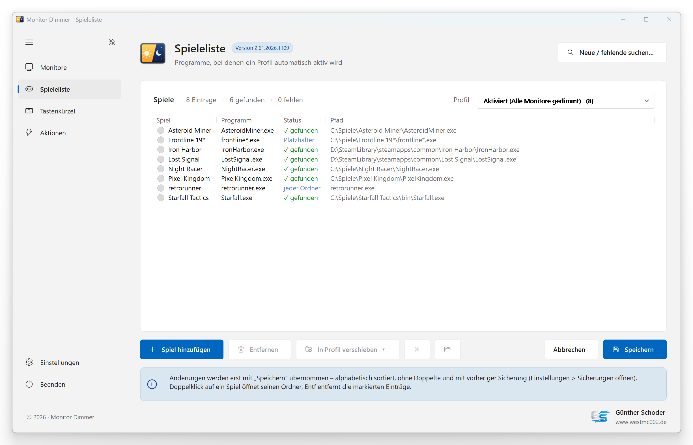 | 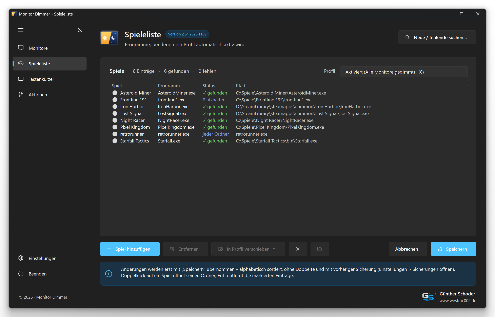 |
| 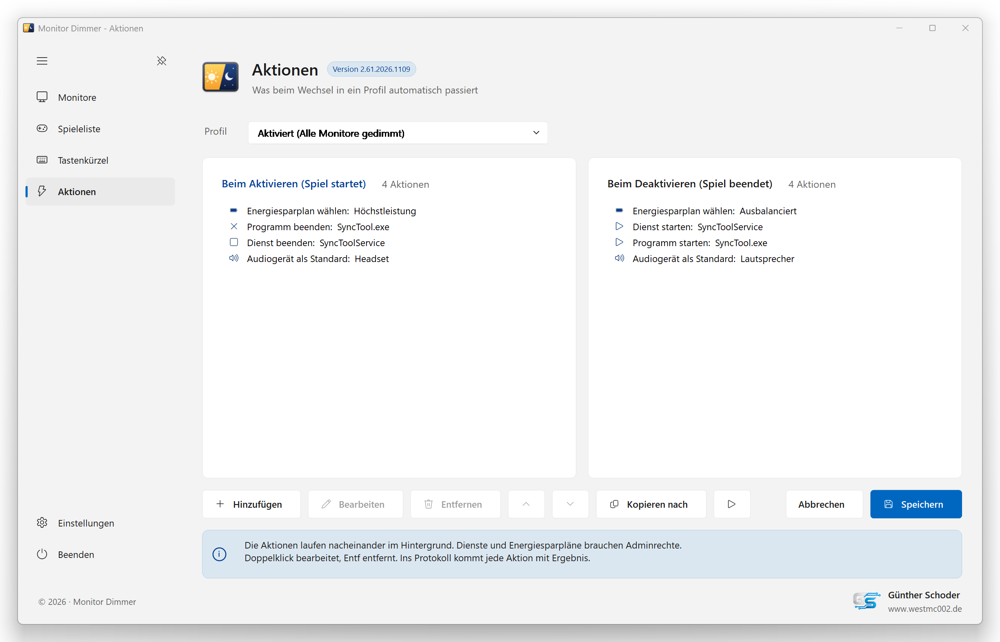 | 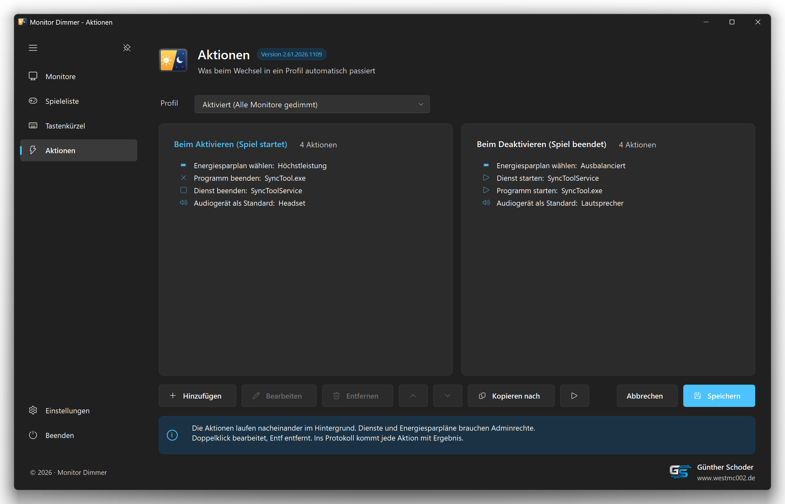 |
| 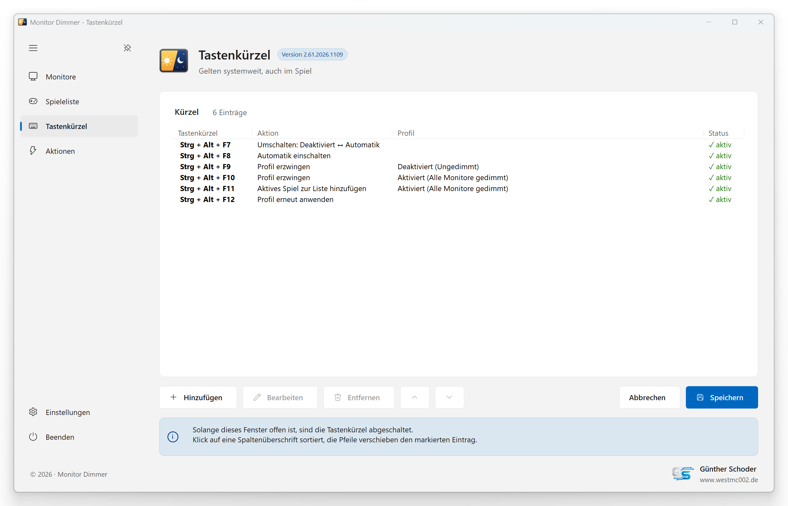 | 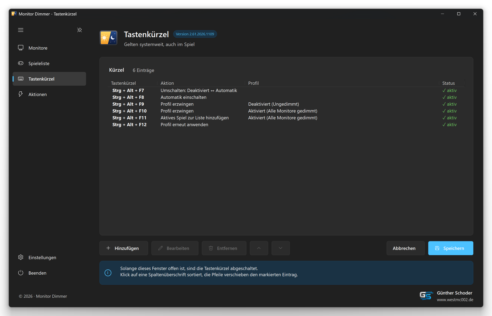 |
| 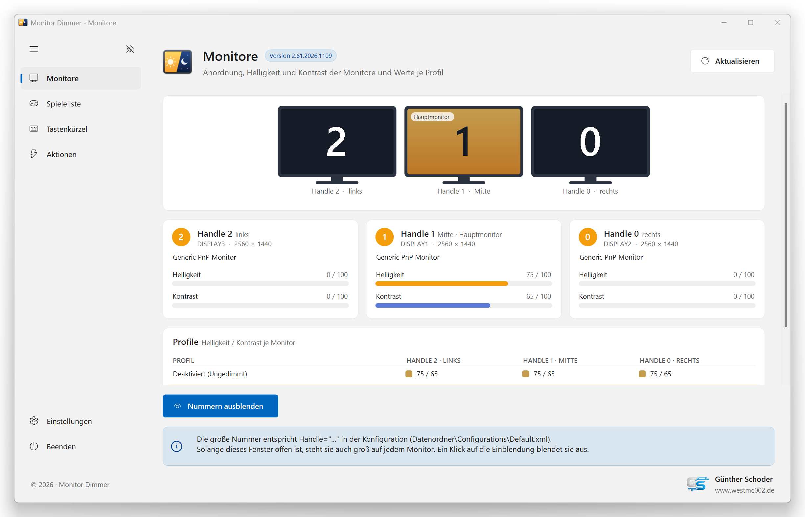 | 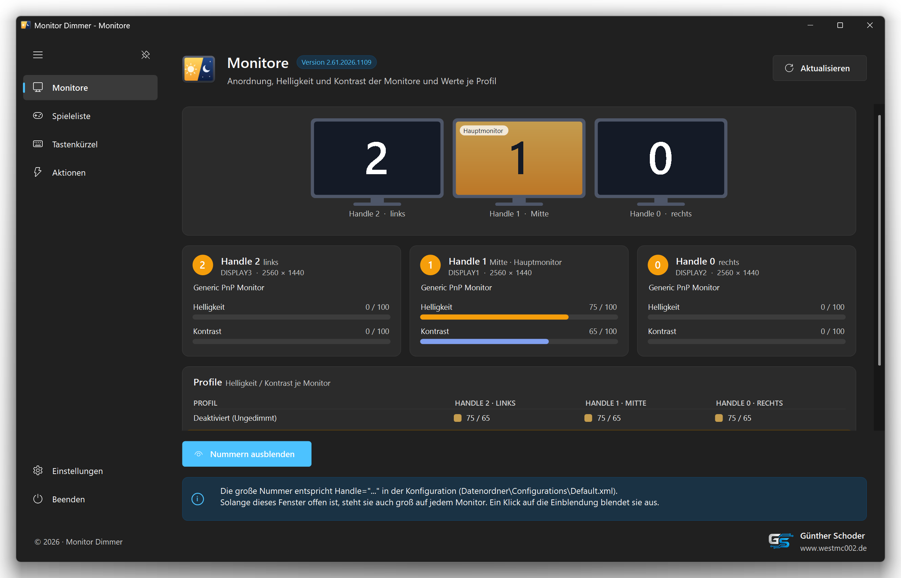 |
| 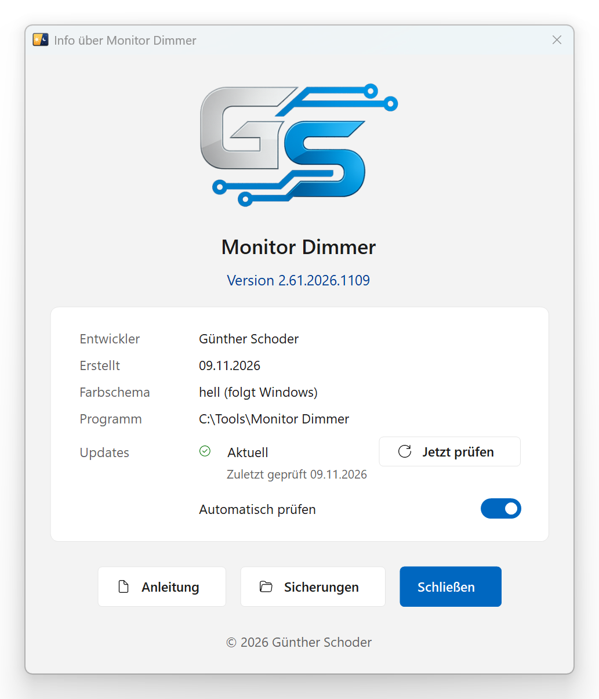 | 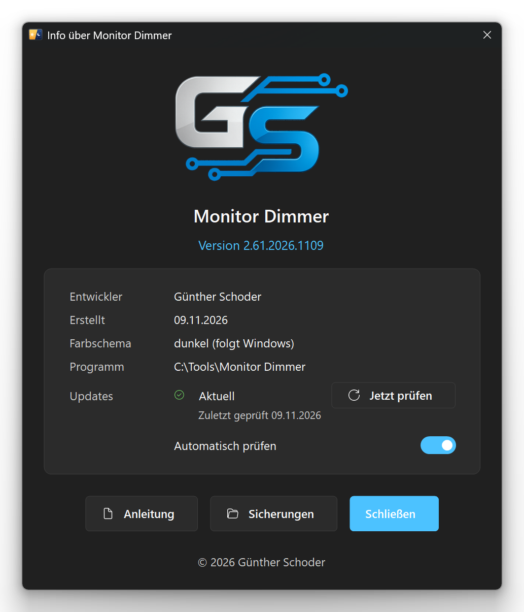 |

Die Screenshots zeigen erfundene Beispieldaten. Sie entstehen automatisch beim Erstellen (`"Monitor Dimmer.exe" --screenshots`).

## Funktionen

- **Profile** – je Profil Helligkeit und Kontrast für jeden Monitor, z. B. „alle gedimmt“, „rechter Monitor heller“, „VR“
- **Automatik** – erkennt das Spiel im Vordergrund; kurzes Alt+Tab oder Overlays dimmen nicht sofort wieder hoch (einstellbare Verzögerung)
- **Spieleliste** – Spiele je Profil mit Icon und Status, Platzhalter `*` und `?`, Suche nach neuen und fehlenden Spielen, Spiel im Vordergrund per Menü oder Tastenkürzel hinzufügen
- **Aktionen** – beim Aktivieren und Deaktivieren eines Profils: Programme beenden und wieder starten, Dienste stoppen und starten, Energiesparplan, Standard-Audiogerät, geplante Aufgaben, Befehle; Prüfung auf fehlende Programme
- **Tastenkürzel** – global, frei belegbar (Pause, Automatik, Profil erzwingen, erneut anwenden …)
- **Monitore** – grafische Übersicht mit Anordnung und aktuellen Werten
- **Ein Fenster** – Monitore, Spieleliste, Tastenkürzel und Aktionen als Seiten mit Navigation (Doppelklick auf das Tray-Symbol); Speichern und Abbrechen je Seite
- **Sicherheit** – beim Beenden, Abmelden und nach Abstürzen werden die Monitore entdimmt; die Konfiguration wird vor jedem Speichern versioniert gesichert
- **Autostart** – mit Adminrechten über die Aufgabenplanung, ohne UAC-Abfrage bei jeder Anmeldung
- **Updates** – sieht höchstens einmal am Tag unter Releases nach einer neuen Version; Installation mit einem Klick im Tray-Menü (Konfiguration bleibt erhalten, abschaltbar im Info-Fenster)

## Installation

1. Unter [Releases](../../releases) die neueste `Monitor-Dimmer-<Version>.zip` herunterladen.
2. `Monitor Dimmer.exe` (und `Liesmich.txt`) in einen eigenen Ordner entpacken, z. B. `C:\Tools\Monitor Dimmer` oder `C:\Program Files\Monitor Dimmer`.
3. Starten. Einstellungen und Protokoll legt das Programm unter `%LOCALAPPDATA%\Monitor Dimmer` an (`Configurations` und `TraceLogs`).
4. Im Tray-Menü unter „Monitore anzeigen …“ prüfen, welche Nummer zu welchem Monitor gehört, und die Profile anpassen.

Voraussetzungen: Windows 10 oder 11 (.NET Framework 4 ist dort vorhanden) und Monitore, die DDC/CI unterstützen (meist im Monitormenü einschaltbar).
Für Aktionen wie „Dienst beenden“ braucht das Programm Adminrechte (Autostart mit Adminrechten im Tray-Menü unter Einstellungen).

## Selbst kompilieren

`Erstellen.bat` im Hauptordner ausführen. Sie nutzt den C#-Compiler aus dem .NET Framework 4, der bei Windows dabei ist – ein Visual Studio ist nicht nötig.
Die Version (Haupt.Neben.Jahr.MonatTag) wird dabei automatisch hochgezählt, die bisherige EXE wird unter `Backup` gesichert, und die Screenshots in `Screenshots` werden neu erstellt.

## Projektaufbau

| Pfad | Inhalt |
|---|---|
| `Quellcode\` | C#-Quelldateien (WinForms, .NET Framework 4) und `app.manifest` |
| `Resources\` | Icon, GS-Logo, Startkonfiguration `Default.xml` und Beispieldaten `Demo.xml` für die Screenshots (werden in die EXE eingebettet) |
| `Screenshots\` | Bilder für diese Seite, hell und dunkel (erzeugt die `Erstellen.bat`) |
| `Erstellen.bat` | Build-Skript |
| `Liesmich.txt` | Ausführliche Beschreibung und Versionsgeschichte |

Zur Laufzeit legt das Programm unter `%LOCALAPPDATA%\Monitor Dimmer` die Ordner `Configurations\` (Einstellungen und deren Sicherungen) und `TraceLogs\` (Protokoll) an. Bis Version 2.59 lagen sie neben der EXE; sie werden beim ersten Start automatisch verschoben.

## Lizenz

GNU General Public License v3.0 oder später – siehe [LICENSE](LICENSE).

Ausnahme: Das GS-Logo (`Resources\GS-Logo.png`) steht nicht unter dieser Lizenz. Alle Rechte vorbehalten; es darf nur unverändert zusammen mit dem Programm weitergegeben werden.

Dieses Projekt ist nicht mit Microsoft, NVIDIA oder Meta verbunden. Genannte Marken gehören ihren jeweiligen Inhabern.

## Autor

Günther Schoder · [www.westmc002.de](https://www.westmc002.de)